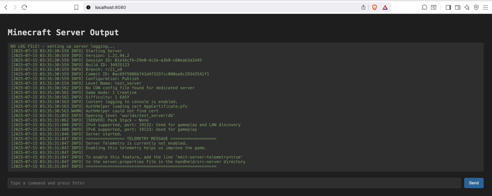

# Minecraft Bedrock Server Wrapper

A lightweight Go wrapper and daemon for managing the official [Minecraft Bedrock Dedicated Server](https://www.minecraft.net/en-us/download/server/bedrock) on Linux.

`minecraft-bedrock-wrapper` automates server lifecycle operations—including downloading server binaries, configuring `server.properties` on the fly via environment variables, monitoring readiness and health for orchestrators like Kubernetes, and providing a real-time web-based interactive console with WebSocket authentication.

---

## Features

- **Automated Download & Extraction**: Downloads and unpacks the requested Minecraft Bedrock Dedicated Server version directly from official Mojang endpoints when specified.
- **Dynamic Configuration via Environment Variables**: Automatically manages `server.properties` by converting environment variables prefixed with `CFG_` into server settings (e.g. `CFG_SERVER_NAME="My World"` -> `server-name=My World`).
- **Interactive Web Console UI**: Built-in browser-based console terminal powered by WebSockets for viewing real-time server stdout/stderr and sending interactive commands (e.g. `op`, `list`, `say`, `stop`).
- **Pre-Shared Key Authentication**: Protects the WebSocket command console with token authentication via HTTP headers (`X-Auth-Key`) or query parameters (`?auth=...`).
- **Container & Orchestration Ready**: Native HTTP health checks (`/health/live` and `/health/ready`) compatible with Kubernetes, Docker, and monitoring agents. Readiness tracks actual server socket listening state.
- **Packaging & Systemd Support**: Shipped as standalone binaries, tarballs, and standard system packages (`.deb` and `.rpm`) with preconfigured systemd unit files and user creation scripts.

---

## Web Console UI

The embedded web UI provides real-time log monitoring and an interactive command prompt to communicate directly with the Minecraft Bedrock server's standard input.



---

## Quick Start

### 1. Accept the EULA

Minecraft Bedrock Dedicated Server requires agreeing to the Minecraft End User License Agreement and Privacy Policy before running:
- [Minecraft End User License Agreement](https://minecraft.net/eula)
- [Microsoft Privacy Statement](https://go.microsoft.com/fwlink/?LinkId=521839)

Set the environment variable `EULA_ACCEPT=true`.

### 2. Run Directly

You must provide `MINECRAFT_VERSION` (or `--mc-version`), as there is **no default version specified** in the application or default configuration. The wrapper uses this to download and extract the Bedrock server binary if it is not already present:

```bash
# Accept EULA and set your authentication key
export EULA_ACCEPT=true
export AUTH_KEY="your-secure-token"

# Specify the Minecraft Bedrock version to download (required)
export MINECRAFT_VERSION="1.21.0.03"

# Run the wrapper
./minecraft-bedrock-wrapper --app-dir ./data
```

Once running:
- **Web UI**: Navigate to `http://localhost:8080/` in your browser and enter your authentication key when prompted.
- **Game Port**: Bedrock clients can connect to UDP port `19132` (or the configured `PORT`).

---

## Configuration

Configuration can be specified through command-line flags or environment variables (environment variables take precedence if set before flag parsing, while flags can override defaults).

### Program Options & Environment Variables

| Flag | Environment Variable | Default | Description |
| --- | --- | --- | --- |
| `--mc-version` | `MINECRAFT_VERSION` | *(Required)* | Bedrock Dedicated Server version to download and extract (e.g. `1.21.0.03`). There is **no default version** specified in the application or default config; this must be provided for the wrapper to fetch the server. |
| `--auth-key` | `AUTH_KEY` | *(Required)* | Pre-shared key for authenticating Web UI and WebSocket console connections. |
| `--app-dir` | `APP_DIR` | Current directory | Working directory containing or targeting the Bedrock server files and `server.properties`. |
| `--listen` | `LISTEN_ADDRESS` | `:8080` | Host and TCP port for the HTTP/WebSocket server. |
| `--port` | `PORT` | `19132` | Minecraft server network port. Sets `server-port` and `server-udp-ports` in `server.properties`. |
| `--command` | — | `./bedrock_server` | Binary or executable to run (primarily used for debugging or custom server binaries). |
| — | `EULA_ACCEPT` | `false` | Must be explicitly set to `"true"` to accept the Minecraft EULA. |

### Dynamic `server.properties` (`CFG_*`)

Any environment variable beginning with `CFG_` is automatically transformed and written to `server.properties` before the server starts.

- Variable names are stripped of the `CFG_` prefix, converted to lowercase, and underscores (`_`) are replaced with hyphens (`-`).
- If the property exists, its value is updated.
- If the property was commented out as a template in `server.properties`, it is uncommented and updated.
- If the property is missing, it is appended to `server.properties`.

**Examples:**

```bash
export CFG_SERVER_NAME="Survival SMP"       # Sets server-name=Survival SMP
export CFG_GAMEMODE="survival"              # Sets gamemode=survival
export CFG_DIFFICULTY="hard"                # Sets difficulty=hard
export CFG_MAX_PLAYERS="20"                 # Sets max-players=20
export CFG_ALLOW_CHEATS="false"             # Sets allow-cheats=false
export CFG_ONLINE_MODE="true"               # Sets online-mode=true
export CFG_VIEW_DISTANCE="32"               # Sets view-distance=32
```

---

## Health Checks & Endpoints

| Endpoint | Method | Authentication | Description |
| --- | --- | --- | --- |
| `/` | `GET` | None | Serves the single-page Web Console UI. |
| `/ws` | `GET` (Upgrade) | `X-Auth-Key` header or `?auth=<key>` | WebSocket connection for real-time log streaming and stdin command dispatch. |
| `/health/live` | `GET` | None | Liveness probe: returns `200 OK` (`{"status":"alive"}`) when wrapper process is alive. |
| `/health/ready` | `GET` | None | Readiness probe: returns `200 OK` (`{"status":"ready"}`) once Bedrock server logs indicate it is bound to ports and ready for connections; otherwise returns `503 Service Unavailable` (`{"status":"not_ready"}`). |

---

## Build Artifacts & Installation

Releases are generated automatically via [GoReleaser](https://goreleaser.com) and published for `linux/amd64`.

### Release Package Formats

| Artifact | Description |
| --- | --- |
| `minecraft-bedrock-wrapper_<version>_linux_amd64.tar.gz` | Archive containing the standalone statically compiled binary. |
| `minecraft-bedrock-wrapper_<version>_linux_amd64.deb` | Debian / Ubuntu package with systemd service and pre/post-install scripts. |
| `minecraft-bedrock-wrapper_<version>_linux_amd64.rpm` | Red Hat / CentOS / Fedora / Rocky Linux RPM package with systemd integration. |
| `minecraft-bedrock-wrapper_<version>_checksums.txt` | SHA-256 checksums for verifying downloaded artifacts. |

### Installing via `.deb` (Debian/Ubuntu)

```bash
sudo dpkg -i minecraft-bedrock-wrapper_<version>_linux_amd64.deb
```

### Installing via `.rpm` (RHEL/CentOS/Fedora)

```bash
sudo rpm -ivh minecraft-bedrock-wrapper_<version>_linux_amd64.rpm
```

### Systemd Service Management

Package installations automatically configure:
- Dedicated system user and group: `minecraft:minecraft`
- Binary installed to: `/usr/bin/minecraft-bedrock-wrapper`
- Service configuration file: `/etc/defaults/minecraft-bedrock-wrapper`
- Systemd service unit: `/etc/systemd/system/minecraft-bedrock-wrapper.service`

**Steps after installing package:**

1. Edit `/etc/defaults/minecraft-bedrock-wrapper` to configure the required parameters (especially `MINECRAFT_VERSION`, which has no default and must be set for the service to start):
   ```bash
   # Required: accept EULA, set authentication key, and define version
   EULA_ACCEPT=true
   AUTH_KEY=your-secure-password
   MINECRAFT_VERSION=1.21.0.03

   # Optional customizations
   APP_DIR=/opt/minecraft
   PORT=19132
   LISTEN_ADDRESS=:8080
   ```

2. Start and enable the service:
   ```bash
   sudo systemctl daemon-reload
   sudo systemctl enable --now minecraft-bedrock-wrapper
   ```

3. Manage and check status:
   ```bash
   # View status
   sudo systemctl status minecraft-bedrock-wrapper

   # Follow logs
   journalctl -u minecraft-bedrock-wrapper -f

   # Restart or stop
   sudo systemctl restart minecraft-bedrock-wrapper
   sudo systemctl stop minecraft-bedrock-wrapper
   ```

---

## Building from Source

### Prerequisites

- [Go](https://go.dev/) (version specified in `go.mod`, 1.24+)
- [GoReleaser](https://goreleaser.com/) (optional, for package builds)
- [golangci-lint](https://golangci-lint.run/) (optional, for quality checks)

### Makefile Targets

```bash
# Build the binary locally (./minecraft-bedrock-wrapper)
make build

# Build release artifacts (.tar.gz, .deb, .rpm in ./dist) via GoReleaser
make artifacts

# Run unit tests
make test-unit

# Run subprocess integration tests
make test-integration

# Run all quality checks (gofmt, go mod tidy, golangci-lint)
make quality

# Format code
make fmt

# Clean build artifacts
make clean

# List all available targets
make help
```

---

## License

This project is licensed under the MIT License.
Minecraft is a trademark of Mojang Synergies AB. This project is not affiliated with or endorsed by Mojang or Microsoft.
